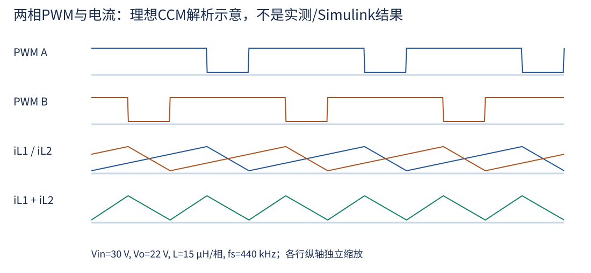

# NOTE-0003：规格冻结、交错原理与电流应力

[全部问题](../../README.md) · [Buck项目索引](README.md)

| 项目 | 内容 |
| --- | --- |
| 创建 / 更新日期 | 2026-11-26（Asia/Shanghai） |
| 所属项目 | 200 W双相交错同步Buck |
| 关键词 | 两相、独立电感、440 kHz、200/220 W |
| 状态 | 理论计算已整理；硬件效率和温升待验证 |

## 问题现象

方案经历参数调整后，需要同时更新电感计算、仿真、采样量程、保护阈值、BOM和PPT。仅改某一张表，可能留下“各模块都像正确、组合起来却不一致”的方案。

本组记录使用以下设计基准；它不是已完成实测的产品规格：

| 参数 | 基准 |
| --- | --- |
| 输入 | 28～32 V，额定30 V |
| 输出 | 18～25 V可调 |
| 功率 | 额定200 W，设计上限约220 W |
| 主电路 | 双相同步Buck，两只独立电感，180°交错 |
| 电感目标 | 每相15 μH；硬件只写“EE22”尚不能证明已满足此目标 |
| 开关频率 | 设计约440 kHz；60 MHz计数实现约441.176 kHz |
| 控制器 | TMS320F28035 |

## 原因分析

理想CCM下，单相占空比近似为 $D=V_o/V_{in}$。本范围约为0.5625～0.8929，不能只检查额定30 V、22 V一个点。

每相交错180°，不同相的上管同时导通可以是正常状态，不能与同一半桥上下管直通混淆。理想情况下奇次开关谐波的合成纹波可部分抵消；不是两个电感电流各自没有纹波。匹配双相、D>0.5时：

$$\Delta I_{\Sigma,pp}=\Delta I_{L,pp}\frac{2D-1}{D}$$

该式是理想稳态关系。轻载断续、死区、相位误差、磁件差异及不均流均会改变结果。合成纹波的重复频率可达2fs，不表示电感计算应直接把每相fs改为2fs。

## 解决方案

按最大功率及最低输出算电流，而不是把200 W一律理解为“10 A”：

$$I_{o,max}=220/18=12.222\ A,\quad I_{phase,avg}=6.111\ A$$

输入电流还依赖效率：若仅作估算取η=96%，$I_{in}=220/(28\times0.96)=8.185 A$。96%不是本项目已测效率。

两相磁件、铜箔及相电流采样按相电流设计；输出端子、分流器按总电流设计。额定功率、设计上限、恒功率限值、固定电流OCP是四个不同约束。固定15 A的OCP并不等于220 W限功率。

## 验证结果

- [x] 按设计范围重算占空比、输入/输出及相电流。
- [x] 将“设计目标15 μH”和“硬件只标EE22”区分。
- [ ] 实测全输入、全输出、满载、轻载和阶跃的效率、峰值与均流。

图为解析示意，不是示波器或Simulink导出结果。

## 经验与复用条件

建立一个带日期的参数主表；改变Vin、Vo、功率、fs或L时，同步更新所有下游材料。旧版仿真图可以留作历史对比，但必须标注旧参数，不能冒充当前方案验证。两个独立电感不使用耦合电感的互感模型或对应纹波结论。

## 参考资料

- [TI：多相Buck学习资料与设计资源](https://www.ti.com/power-management/non-isolated-dc-dc-switching-regulators/step-down-buck/overview.html)
- 本条公式由理想CCM电感伏秒关系推导；实际验证边界见[仿真记录](NOTE-0014-discrete-simulation-and-editable-calculations.md)。
