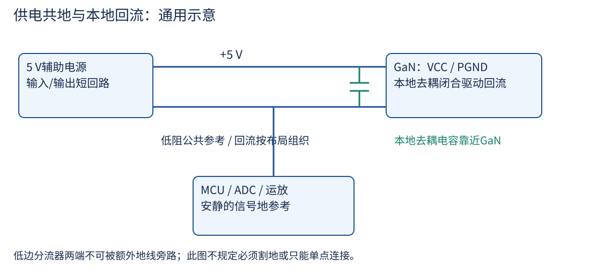

# NOTE-0008：辅助电源、GND/PGND及3.3 V电源并联

[全部问题](../../README.md) · [Buck项目索引](README.md)

| 项目 | 内容 |
| --- | --- |
| 创建 / 更新日期 | 2026-11-26（Asia/Shanghai） |
| 所属项目 | 200 W双相交错同步Buck |
| 关键词 | SY8303A、ME6211、去耦、回流、低边分流器 |
| 状态 | 名义计算与网表已核对；最差条件和回流待验证 |

## 问题现象

5 V辅助电源地叫GND，GaN地叫PGND，是否需要另一个隔离5 V？PWM滤波电容到底接哪个地？同一板上两个3.3 V稳压器能否直接并联？

## 原因分析

地名不是隔离器。非隔离系统需要可靠公共参考，区别在大电流、高频和模拟返回路径。直流经0 Ω相通，也不能证明高频回流短而干净。

辅助电源名义输出：

$$V_{5V}=0.6(1+200k/27k)=5.0444\ V$$

SY8303A的频率近似 $f_{sw}(kHz)=10^5/R_{FS}(k\Omega)$。47 kΩ约2.128 MHz，32 V→5.044 V所需Ton约74 ns，低于手册80 ns典型最小导通时间，不能保证全范围固定频率正常工作。改100 kΩ约1 MHz后，名义Ton约158 ns。自举C16从10 nF改100 nF，符合厂家推荐起点。

## 解决方案

- GaN VCC电容负端回本芯片PGND，PWM输入滤波电容也回接收端本地PGND。
- SY8303A输入/输出功率电容与芯片地形成短回路，反馈和设定电阻从本地安静地取参考。
- MCU、霍尔信号侧、采样运放和参考分压使用安静信号地；霍尔使用5 V不意味着其信号地一定归大电流PGND。
- 对GaN优先考虑低阻连续地平面及分区布局，避免PWM跨地缝、返回绕远；若保留两个网名，需明确实际汇接方式。不能把“单点接地”当成所有高频版图的固定答案。
- 低边输入/输出分流器把外部负端与内部PGND隔开，额外地线、USB、仪器或负载共地可能旁路分流器，需从整机接线检查。
- 两块板各自的3.3 V输出不能默认可直接并联；选一个源、明确DNP或使用经过设计的电源选择。
- LDO损耗先估 $P=(5-3.3)I$，100 mA约0.17 W，200 mA约0.34 W，还要计封装和铜皮热阻。

## 验证结果

- [x] 反馈、频率、自举及本地地归属已计算/静态核对。
- [x] 纠正过度表述：C6/C11“接GND”不因网名就必然接错，应检查真实高频回路。
- [ ] 5 V稳态/跌落、LDO结温、完整回流和分流器旁路待实测。

## 经验与复用条件

输入电容还要核对直流偏压后的有效容量、热插拔尖峰和IC耐压。TVS标称33 V不意味着实际钳位会低于辅助芯片40 V极限。电源改动同时影响比较器输入范围、霍尔零点和ADC量程，不能局部看待。

## 参考资料

- [Silergy：SY8303A官方手册](https://www.silergy.com/download/downloadFile?ftype=note&id=3854&type=product)
- [ISG3202LA引脚参考](https://www.codico.com/en/mpattachment/file/download/id/1402/)
- [Analog Devices：When Grounds Are Separated](https://www.analog.com/en/resources/analog-dialogue/raqs/raq-issue-159.html)
