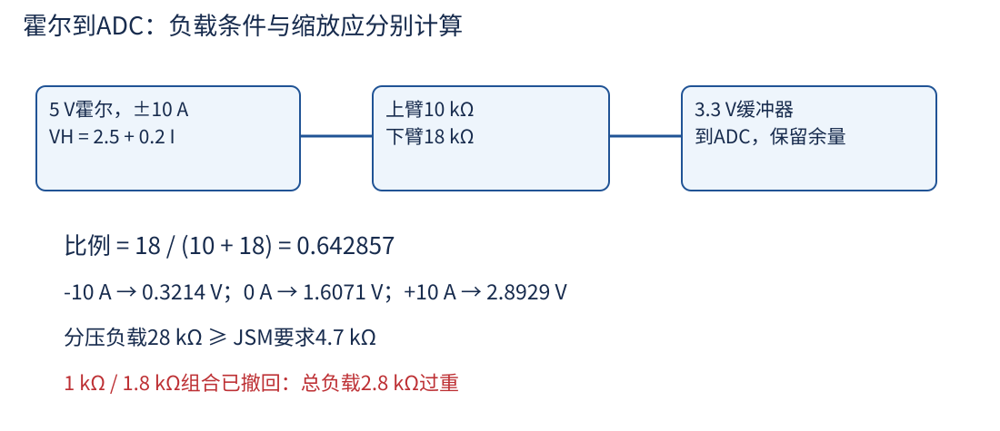

# NOTE-0010：相电流采样：INA241、JSM霍尔、缩放与带宽

[全部问题](../../README.md) · [Buck项目索引](README.md)

| 项目 | 内容 |
| --- | --- |
| 创建 / 更新日期 | 2026-11-26（Asia/Shanghai） |
| 所属项目 | 200 W双相交错同步Buck |
| 关键词 | 双通道、双向、ACS724-JSM、4.7 kΩ、440 kHz |
| 状态 | 手册与比例已核对；纹波保真度和闭环带宽未实测 |

## 问题现象

一个INA241能否测两相？440 kHz时能否看到详细三角电流？ACS724LLCTR-10AB-T-JSM后级用33 kΩ/10 kΩ还是3.3 kΩ/1 kΩ？

## 原因分析

除隔离放大器外，可比较：非隔离分流器＋宽共模电流检测器、霍尔/磁传感器、电感DCR取样。DCR取样需匹配RC与L/DCR时间常数并做铜温补偿；CT/Rogowski主要测变化量，不能直接当直流平均电流传感器；MOS导通电阻取样还受温度及工作状态影响。

一个INA241是一通道；两路独立连续测量通常用两通道。时分复用会引入切换、建立和非同时采样问题，不等于同一时刻测两相。

**带宽不等于开关共模抑制能力。** INA241手册列1.1 MHz小信号带宽，同时在增强PWM抑制特性中列支持开关频率至125 kHz。因此不能只凭1.1 MHz就承诺440 kHz开关节点共模条件下能准确还原细节。放在电感输出侧可能有较安静共模，但仍需按实际共模、差模、采样位置和建立时间验证。

JSM型号必须看JSM手册，不直接套用Allegro同名ACS724参数。5 V、10AB的名义信号为 $V_H=2.5+0.2I$。后级曾用“1 kΩ输入、3.3 kΩ接地＋相应反馈”的四电阻网络，总增益是3.3；零电流要求输出8.25 V，必然饱和。

## 解决方案

两种已讨论的可用比例：

| 方案 | 输出与量程 |
| --- | --- |
| 四电阻总增益0.33，10 kΩ/3.3 kΩ匹配 | VADC=0.825+0.066I，±10 A对应0.165～1.485 V |
| 10 kΩ串联＋18 kΩ接地分压，之后跟随器 | VADC=1.60714+0.128571I，±10 A约0.3214～2.8929 V |

第一种可用，但±10 A跨度只用满量程约40%；这是量程取舍，不再是饱和错误。两电阻直接分压与四电阻差分增益不同：33 kΩ上臂、10 kΩ下臂为10/43=0.2326，缩小4.3倍；匹配差分网络Rf/Rin=10/33才是约缩小3.3倍。3.3/10=0.33实际缩小约3.03倍。

JSM手册要求输出电阻负载至少4.7 kΩ。有缓冲器时，33 kΩ＋10 kΩ这档负载较轻；3.3 kΩ＋1 kΩ总4.3 kΩ低于该要求。**初步建议过的1 kΩ＋1.8 kΩ总负载2.8 kΩ已撤回，应使用10 kΩ＋18 kΩ等满足负载要求的组合。** 较低阻值通常有较低热噪声和更强抗扰，但不能以违反传感器负载条件为代价。

100 Ω＋330 pF的极点约4.82 MHz，不是平均电流滤波器。缓冲后的ADC驱动能力与传感器前端负载应分开分析；需按完整采样链和ADC采样窗口验证。

## 验证结果

- [x] JSM负载和比例已核对，过小电阻建议已明确更正。
- [x] INA241的125 kHz PWM条件与1.1 MHz带宽已区分。
- [ ] 未认定现有霍尔链能准确还原440 kHz三角纹波。
- [ ] 未认定平均电流均流通道具备逐周期峰值保护能力。

## 经验与复用条件

三角波含高次谐波，幅值、相位和大信号建立均影响波形保真。传感器带宽、运放闭环带宽、RC、ADC采样和数字滤波要逐段审查。典型带宽在某电流档、某滤波电容下测得，也不能直接推广到所有变体。

## 参考资料

- [TI：INA241A/B官方手册](https://www.ti.com/lit/ds/symlink/ina241a.pdf)
- [JSM：ACS72x系列厂家手册镜像，第2、4、5页](https://atta.szlcsc.com/upload/public/pdf/source/20250818/D6C927C5A83E3F199EEB31BF095A3AE3.pdf)
- [GS8552厂家手册镜像](https://atta.szlcsc.com/upload/public/pdf/source/20200615/C605420_EE0E567F8FF01D919583B114644E1CC3.pdf)
