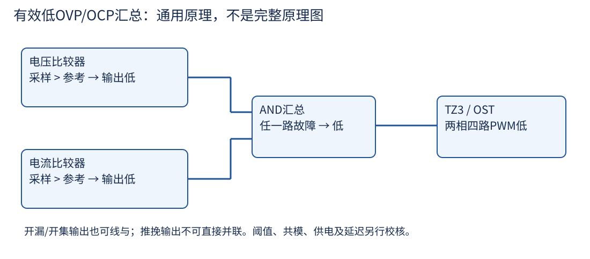

# NOTE-0011：硬件过压过流：比较器、阈值与误差预算

[全部问题](../../README.md) · [Buck项目索引](README.md)

| 项目 | 内容 |
| --- | --- |
| 创建 / 更新日期 | 2026-11-26（Asia/Shanghai） |
| 所属项目 | 200 W双相交错同步Buck |
| 关键词 | LM393B、TLV3201、TLV9022、AND、输出轨 |
| 状态 | 名义阈值和静态连接已核对；保护动态待测试 |

## 问题现象

目标是复用输出电流/电压采样，用比较器将故障送入TZ3。曾出现比较器和与门VCC只接去耦电容、没有接电源，以及计划3.3 V供电比较2.42/2.83 V的情况。

## 原因分析

LM393B不是轨到轨输入。在3.3 V供电下，全温保证的共模上限按VCC−2 V约为1.3 V，不能保证2.42/2.83 V附近两个输入的正常比较。5 V供电、开集输出上拉3.3 V可以分开确定输入范围和DSP逻辑电平，但还需最差裕量。

实际链路由分流器→GS8552高增益→比较器→逻辑→DSP TZ→缓冲→GaN组成。GBW近似1.8 MHz、噪声增益201时，GS8552闭环带宽量级约9 kHz；新增40 ns比较器不能消除前级的延迟。

## 解决方案

参考接比较器正端、采样接负端：正常输出高，采样超参考时输出低。LM393B用3.3 V上拉；两个有效低故障可由AND合并。仅对开集/开漏输出，也可直接并联形成线与并共用上拉，不能把两个推挽输出直接并联。

| 参数 | 名义计算 |
| --- | --- |
| 输出电压采样比例 | 0.11 |
| OVP：上臂1.5 kΩ、下臂9.1 kΩ，参考源3.3 V | Vref=2.833019 V，输出阈值25.7547 V |
| 输出电流采样 | 1 mΩ×200=0.2 V/A |
| OCP：上臂3.3 kΩ、下臂9.1 kΩ | Vref=2.421774 V，电流阈值12.1089 A |
| OCP仍用下臂9.1 kΩ，上臂改1.6 kΩ示例 | 约14.03 A |
| 15 A阈值的另一分压例 | 3.3 V经上臂1 kΩ/下臂10 kΩ得到3.0 V |

12.11 A在18 V约218 W，接近220 W设计上限；若目标就是约12 A，比例符合标称，但不能保证220 W加阶跃裕量。示例14/15 A不是已批准实物指标，还须核对磁件峰值和关断延迟。

若3V3±2%、有关电阻±1%，仅参考与采样增益极端组合就可把25.75 V移到约24.67～26.88 V。再举例计SY8303A基准0.591～0.609 V及反馈电阻±1%，5 V最小估约4.882 V，最高OV参考约2.898 V，要求VCC>4.898 V才能覆盖参考端VCC−2 V条件，已无保证裕量。这些是明确假设的算例，不是实物误差测量。

可改精度、参考或选轨到轨输入器件，例如TLV9022DDFR双路开漏，3.3 V供电，核对实际DDF焊盘。若只需单路，TLV3201推挽比较器可直接产生3.3 V故障电平。Rseries=100 Ω、C=330 pF可作小RC，不提供锁存；正反馈迟滞会改变阈值，须重算。

## 验证结果

- [x] 名义阈值、极性、输出类型和供电范围已核对。
- [x] 后续原理图已补比较器5 V、AND 3.3 V供电；PCB是否同步需单独确认。
- [ ] 尚未实测阈值、公差、迟滞、故障保持、失电及总延迟。
- [ ] 没有认定该总电流过载通道已覆盖GaN直通或所有短路。

## 经验与复用条件

温度、误差和负载跌落要组成一致的最差工况，不能只把5 V和2.83 V标称值作比较。C4等器件的耐压要覆盖过压阈值与超调；25.75 V OVP不能证明25 V电容安全。关断PWM也不能阻止输出电容已存储能量流向外部短路。

## 参考资料

- [TI：LM393B官方手册，输入范围及单输入有效条件](https://www.ti.com/lit/ds/symlink/lm393b.pdf)
- [TI：TLV3201](https://www.ti.com/lit/ds/symlink/tlv3201.pdf)
- [TI：TLV9022](https://www.ti.com/lit/ds/symlink/tlv9022.pdf)
- [TI：SN74LVC1G08](https://www.ti.com/lit/ds/symlink/sn74lvc1g08.pdf)
