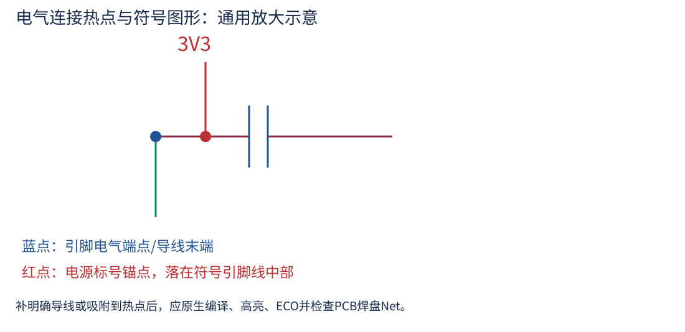

# NOTE-0013：看似连通的电源标号、焊盘网名与原生验证

[全部问题](../../README.md) · [Buck项目索引](README.md)

| 项目 | 内容 |
| --- | --- |
| 创建 / 更新日期 | 2026-11-26（Asia/Shanghai） |
| 所属项目 | 200 W双相交错同步Buck |
| 关键词 | Altium、hotspot、匿名网、ECO、重复编号 |
| 状态 | 静态证据及一次原理图修正已确认；原生ERC/DRC待执行 |

## 问题现象

“图上明明有3V3”与“IC供电脚属于3V3网”并不是同一个检查结果。一次案例中，电源标号放在电容引脚线中段，距引脚电气端点5个坐标单位，视觉上相接，但PCB中供电脚仍是匿名网。

## 原因分析

检查证据应包括：

1. 标号的电气锚点；
2. 引脚的外侧电气热点；
3. 实际导线，而不只是符号图形线；
4. 原生编译和网络高亮；
5. PCB对应焊盘的真实Net。

历史案例的标号点(210,550)、引脚/导线端点(205,550)，PCB为NetC9_2而非3V3。最终通过显式短线/吸附修正后，原理图重建才归入3V3。坐标单位不是毫米，不能把差5理解成5 mm。

## 解决方案

将标号吸附至有效电气端点或补一段明确导线，然后原生编译、高亮、ECO，再检查PCB焊盘Net。供电芯片VCC只连接去耦电容而未连接电源，也是“看起来有电源部分但实际上浮空”的常见问题。

批量静态审查可读网表、元件值和焊盘网络，对比：电源名、同一节点成员、反向极性、采样电阻比、匿名电源网、未编号器件、重复引脚与漏更新BOM。识别多分部器件、隐藏/非当前分部、锡膏焊盘和合并功率焊盘，不能简单按记录数量判元件数或漏接。

主板符号曾有两个“7脚”，其中一脚暂时未用；即便当前PCB映射可核对，重复编号仍应在库里修正，避免后续ECO歧义。三只新端子若只是未注释，必须先唯一编号，再更新PCB。

## 验证结果

- [x] 使用SchDoc记录与PCB铜焊盘网络双重定位过匿名供电网。
- [x] 最新一次原理图供电点修正已确认；当时磁盘PCB仍是旧版本。
- [ ] 静态重建不是Altium原生编译器，不能把它称作原生ERC/DRC通过。
- [ ] 没有把CAD网名正确等同为实物焊接/连通测试通过。

## 经验与复用条件

沟通中应先承认图上确有标号，再指出热点、导线和PCB网名证据，避免只重复“没接”。若原生高亮/编译与自写解析不同，应以原生结果核实解析假设；不能仅凭一张放大图下绝对结论。

## 参考资料

- [Altium：创建电路连接](https://www.altium.com/documentation/altium-designer/schematic/creating-circuit-connectivity)
- [Altium：原理图连线与引脚热点](https://www.altium.com/documentation/altium-designer/tutorial/capturing-schematic)
- [Altium：设计验证](https://www.altium.com/documentation/altium-designer/schematic/design-validation)
