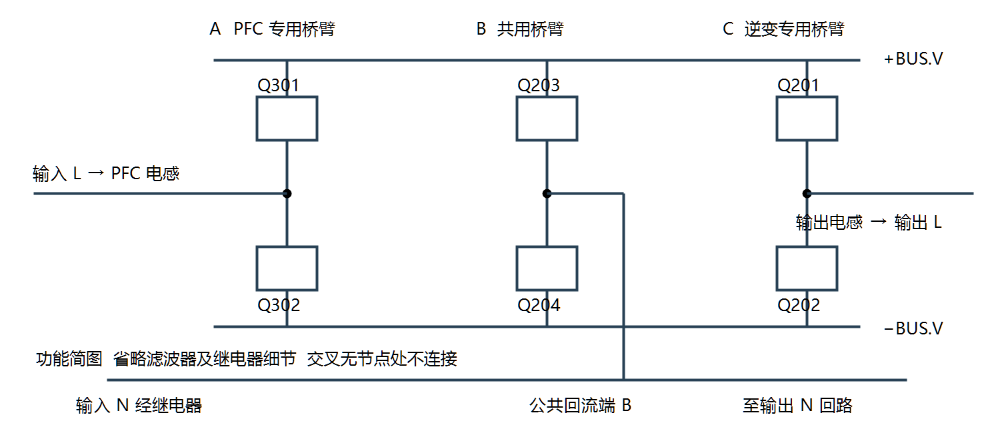
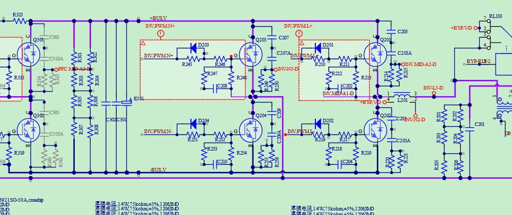
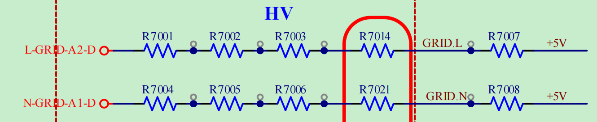
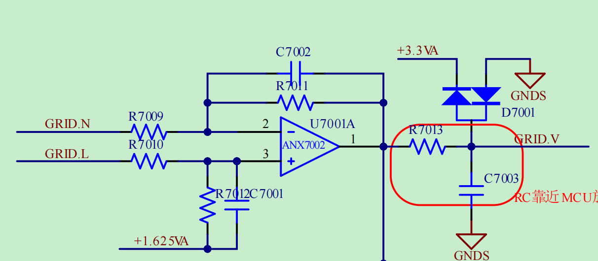
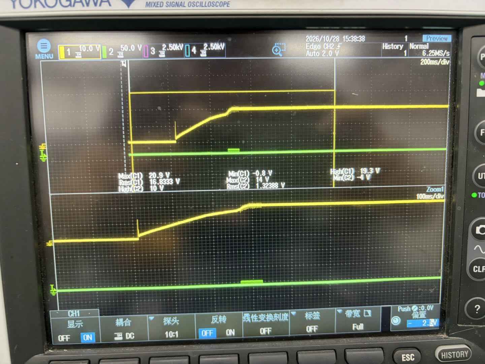
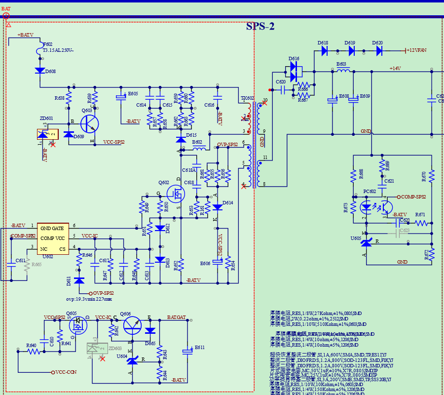
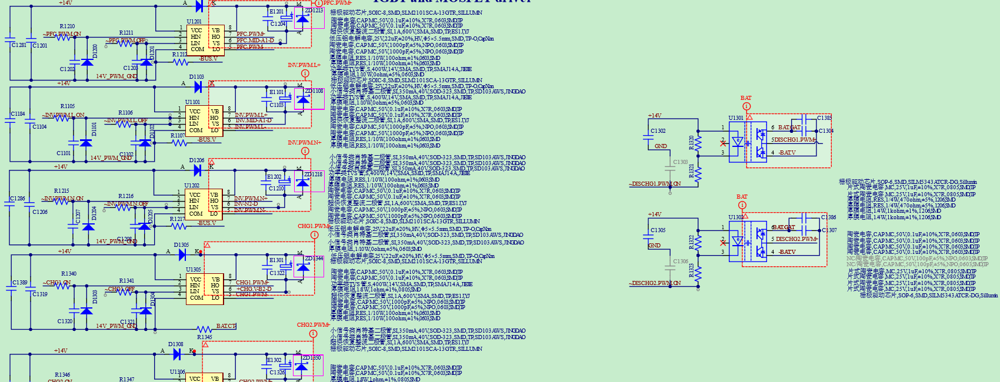
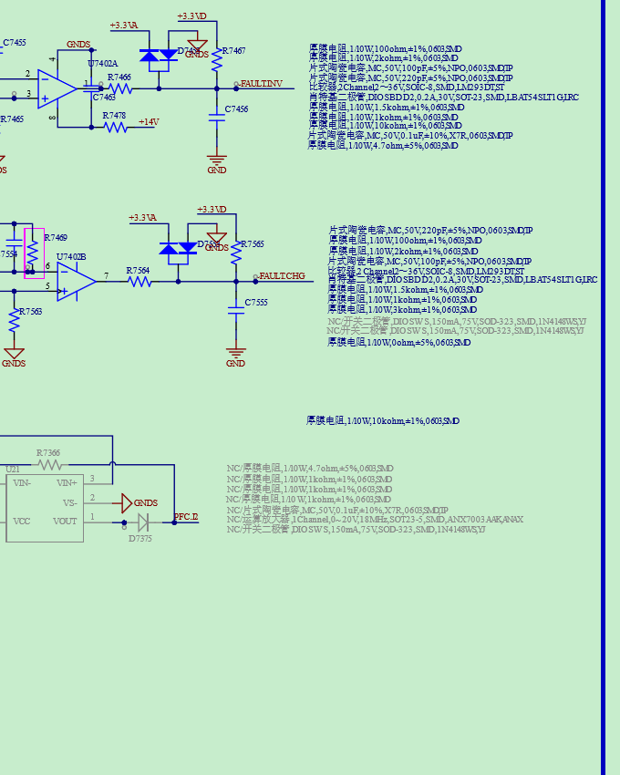
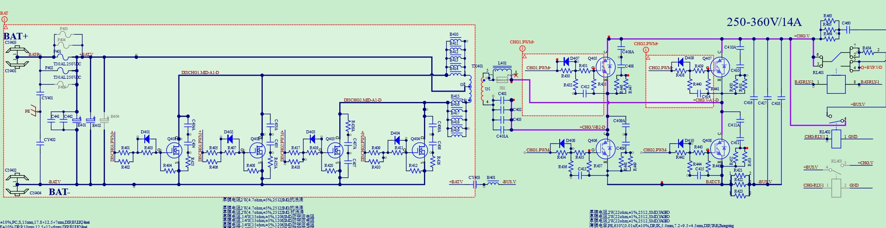

# NOTE-0002：UPS 学习记录

| 项目 | 内容 |
| --- | --- |
| 原记录日期 | 2026-10-30 |
| 同步日期 | 2026-11-07 |
| 所属项目 | UPS / U.PSDR.L.CT3K C25285 |
| 关键词 | 共用桥臂、PFC、采样偏置、VCC启动、PMOS、驱动、保护 |
| 状态 | 原理分析及部分实测已确认；具体根因与修复验证见各节 |
| 来源 | [飞书 UPS学习记录](https://scnv916iljvi.feishu.cn/docx/SryQdclcDoecoTx0dJ6cBl5PnQc)，版本 43 |

正文由飞书原文同步，仅调整 GitHub Markdown 格式与导航。图片和 PDF 已归档到本仓库，可直接查阅；GitHub 不显示原文的彩色文字，以加粗和文字标签突出重点。

### 阅读导航

先看各节的结论，再按需要展开原理、实测和排查步骤。

- [问题 001  三桥臂共用原理](#issue-001)
- [问题 002  市电采样偏置与运放输入范围](#issue-002)
- [问题 003  VCC 启动跌落与 PMOS 导通](#issue-003)
- [学习专题 004  八个 UPS 设计学习点](#study-004)
- [参考原理图  完整 PDF 附件](#schematic)

**阅读标记：重点结论使用加粗；已确认、待验证和示例的区别以正文说明为准。**

记录已确认的硬件调试问题、原理分析和待实测事项。适用于 U.PSDR.L.CT3K C25285 原理图的学习与调试；拓扑或公式推导不代表整机功能已经实测验证。

维护方式：先讨论问题，用户确认后再归档；后续测量数据和修正结论补充到对应问题。最近整理日期：2026年10月30日。

## 问题 001  三桥臂 AC AC 电路的共用桥臂原理

记录日期：2026年10月30日    状态：用户已确认归档

### 问题与结论

问题：使用三个半桥组成图腾柱 PFC 和全桥逆变器，实现 AC–AC 变换时，中间桥臂是否被两级复用，为什么可以这样连接？

结论：本图中 **Q203 与 Q204 构成共用桥臂**。它与左侧 Q301、Q302 配合完成 PFC，与右侧 Q201、Q202 配合完成逆变。**两级共用交流回流端**，控制器协调该桥臂状态，使输入电流控制与输出电压控制同时实现。

### 器件与功能

| 位置 | 器件 | 功能 |
|-|-|-|
| 左侧 A | Q301、Q302 | PFC 专用桥臂 |
| 中间 B | Q203、Q204 | PFC 与逆变共用桥臂 |
| 右侧 C | Q201、Q202 | 逆变专用桥臂 |

图 1  三桥臂功能连接示意。B 为公共交流回流端，不是直流负母线。

### 原理图连接核对

来源：U.PSDR.L.CT3K C25285.pdf，第 2 页顶部 Power supply distributor 功率电路。以下结论针对图示连接；继电器在不同模式下的状态仍应结合控制逻辑核对。

图 2  原理图桥臂局部。左侧为 PFC 桥臂，中间为共用桥臂，右侧为逆变输出桥臂。

输入 L 路径：IN.L 经输入滤波、RL101、PFC 电感 L301 及电流检测，接入 Q301、Q302 的中点 A。

公共回流路径：IN.N 经输入滤波及 RL102 接入公共回流线；该线连接 Q203、Q204 的中点 B，并接入输出回流回路。

输出 L 路径：Q201、Q202 的中点 C 经 L201，接入输出滤波及切换回路。旁路继电器的存在意味着不能把所有运行模式都视为同一条供电路径。

读图要点：底部**公共交流回流线与 −BUS.V 是不同网络**。跨线处没有连接节点时不能视为连接，不能将输入 N 或输出 N 直接理解为直流母线负端。

### 共用原理

以直流母线负端为电压参考，三个桥臂中点电压分别记为 vA、vB、vC。两级的桥间电压为：

PFC 桥间电压：vAB = vA − vB

逆变桥间电压：vCB = vC − vB

PFC 利用 vAB 与输入交流电压之间的差值调节电感电流；逆变器利用 vCB，经输出滤波得到负载电压。二者都以 B 为共同回流端，因此可以合并原本重复的回流桥臂。

这并非分时借用：**两级可以同时工作**，共用桥臂承担公共回流电流。**B 的开关状态必须由统一的调制策略协调**。

### 工频换向的工作方式示例

以下用于解释原理，条件是**输入与输出同频同相**，且 B 桥臂按工频换向。原理图没有给出实际栅极时序，**不能据此认定本板固件必然采用这一策略**。

正半周：Q204 导通，B 接近 −BUS.V。A 桥臂通过高频开关控制 PFC 输入电流；C 桥臂通过高频开关，使 vCB 在 0 与 +Vdc 之间切换，滤波后得到正半周输出。

负半周：Q203 导通，B 接近 +BUS.V。A 桥臂继续配合输入电感控制电流；C 桥臂使 vCB 在 −Vdc 与 0 之间切换，滤波后得到负半周输出。

实际换向需考虑死区、过零附近电流及器件续流路径；上述说明省略了这些瞬态过程。

### 适用条件与调试关注点

控制协调：PFC 与逆变不能分别向 B 桥臂下达相互冲突的开关命令。桥臂复用减少两只功率开关，但也引入调制耦合。

相位与频率：上述工频换向方式要求输出极性配合输入半周。若需要独立变频或移相，应重新设计调制策略，并核查母线电压和调制余量。三桥臂结构本身不等于只能同频同相。

电流应力：共用桥臂承担输入与输出的合成回流电流。明确参考方向后，应按节点电流定律计算；在方向相反时可部分抵消，但不能假定始终很小。需覆盖无功负载、非线性负载、瞬态和运行模式变化。

电气隔离：图示交流主功率路径没有输入输出电气隔离。电池变换部分的变压器不等于交流主回路隔离；公共 N 也不等于保护地 PE。

### 验证状态与后续核查

**已确认：**三个桥臂的器件对应关系、**Q203 与 Q204 的共用连接**及公共交流回流端。

**待实测：**本板中间桥臂的实际开关频率、过零换向时序、输入输出相位关系，以及 RL101、RL102、RL103 在各运行模式下的动作状态。可通过固件和栅极波形进一步核实。

本条尚无硬件实测结果，不能把拓扑分析记作整机功能或性能已验证。

## 问题 002  市电采样偏置与运放输入范围

记录日期：2026年10月30日    状态：用户已确认归档

### 问题与结论

问题：市电采样前级已通过电阻接到 +5 V，后级为何还引入 +1.625 VA？前级为什么需要调整共模电位？改用双电源运放后是否就不需要偏置？

结论：两处参考承担不同作用。**前级 +5 V 调整两路采样网络的工作电位**，其共同贡献在理想匹配的差分电路中抵消；**后级 +1.625 VA 设定输出零点**，使交流采样信号适配 MCU ADC。前级上拉是否为本板正常工作的必要条件，仍需核查供电、器件规格及全工况电压。

图 3  市电前级采样。R7007、R7008 接 +5 V；圈出的 R7014、R7021 属于高压串联电阻链。

图 4  带 +1.625 VA 参考的差分放大电路。R7013、C7003 用于输出 RC 滤波，D7001 用于电源轨钳位保护。

来源：U.PSDR.L.CT3K C25285.pdf，第 2 页 AD sample 与第 1 页 LINE INV BUS CHG VOLTAGE；图 3、图 4 采用本次讨论提供的局部截图。

### 两处偏置如何共同作用

前级：GRID.L、GRID.N 的电位由市电端、高压电阻链、接 +5 V 的电阻及后级输入网络共同决定。接 +5 V 不等于采样节点就是 5 V，也不能保证运放输入脚在所有工况下都不出现负电压。

后级：图示 R7009 = R7010 = 30 kΩ，R7011 = R7012 = 3.6 kΩ。忽略电容的低频影响，并假设运放处于线性区，则：

**VGRID.V ≈ 1.625 V + 0.12 × (VGRID.L − VGRID.N)**

这里 0.12 = 3.6 kΩ ÷ 30 kΩ，是从 GRID.L、GRID.N 节点到输出的差分增益，不是市电到 ADC 的整条链路增益。+1.625 VA 还会通过 R7012 影响同相输入脚电位，并非只作用于输出。

### 前级共同偏置为何抵消

设两路前级完全匹配，每路高压串联电阻总和为 RH，接 +5 V 的电阻为 RB。对后级作戴维南等效，令 α = RB ÷ (RH + RB)，则两路等效源为：

Veq,L = α × VL + (1 − α) × 5 V

Veq,N = α × VN + (1 − α) × 5 V

Veq,L − Veq,N = α × (VL − VN)

共同的 +5 V 项因此抵消。每路等效源还串联 RH ∥ RB，必须计入总增益计算。实际电阻失配会使共同偏置或电源扰动部分转化为差分误差，表现为零点偏差或噪声。

### 为什么需要关注共模电位

运放既要求输入差值合适，也要求输入脚相对供电轨的电位满足工作范围。例如两输入分别为 1.50 V、1.51 V，与分别为 −0.50 V、−0.49 V，差值均为 −0.01 V，但后一种情况对不允许负输入的单电源运放可能已经超出正常范围。

输入共模电压 VCM = (V+输入 + V−输入) ÷ 2。在线性负反馈工作时，两输入电位接近；应核对真实的第 2、3 脚电位，不能直接把 GRID.L、GRID.N 当成运放引脚电压。

前级上拉可以用于调整该工作点，但本板采用 +5 V 上拉的具体必要性，尚未通过参数计算或测量确认。

### 单双电源与偏置的关系

核心原则：是否需要偏置**取决于运放输入范围、运放输出范围及后级 ADC 范围**，**不能只根据单电源或双电源判断**。双电源通常更方便处理以 0 V 为中心的交流信号，但不自动取消所有偏置。

输入范围并不必然覆盖供电轨。单电源运放不一定允许输入达到 0 V 或 VCC；双电源运放也不一定允许输入达到 −VCC 或 +VCC。**正常工作应查输入共模范围**，**不能把绝对最大额定值当作线性工作范围**。轨到轨输入器件也应以其手册规定为准。

普通运放通常只有正、负供电脚，没有单独的 GND 引脚；电路中的地是选定的参考点。双电源也可以是不对称的正、负电源。

### 以 −1 V 至 +1 V 信号为例

情况一：运放采用 0 V 至 5 V 供电，且不允许负输入。通常需要偏置，或通过输入网络把实际引脚电位变换到允许范围内。

情况二：运放采用 ±5 V 供电，且输入共模范围、输出摆幅均满足信号要求。可以不加偏置，保留以 0 V 为中心的波形。

情况三：运放采用 ±5 V 供电，但输出连接只接受 0 V 至 3.3 V 的 MCU ADC。仍需把最终波形平移到 ADC 可接受的范围；运放能输出负电压，不代表 ADC 能接收负电压。

### 对本板的判断与后续核查

前级 +5 V：若其作用确为满足输入共模范围，换用合适的双电源后可能可以取消；但必须重新计算输入网络、采样增益和各模式下的引脚电位，不能直接删除电阻。

后级 +1.625 VA：用于设定 ADC 采样波形中心。即使运放改为双电源，只要 ADC 仍不接受负压，该输出偏置就仍有作用；其影响也需与输出摆幅一起检查。

**待核查：**U7001A 实际供电轨及 ANX7002 手册；市电全周期和各运行模式下第 2、3 脚电压范围；输出摆幅与 ADC 允许范围；保留、改接地及移除前级上拉时的完整网络计算。**当前尚无该采样链路的实测结果**。

### 参考资料

Texas Instruments  Op Amp Voltage Ranges—input and output, clearing some confusion。说明输入共模范围、输出范围与供电轨的区别。

[TI 官方技术说明](https://e2e.ti.com/blogs_/archives/b/thesignal/posts/op-amp-voltage-ranges-input-and-output-clearing-some-confusion)

## 问题 003  按键启动时 VCC 供电跌落与恢复

记录日期：2026年10月30日。状态：用户已确认归档；供电跌落现象已实测，具体器件原因待定位。

### 问题与实测条件

按下控制板按键后，VCC-IC 出现窄尖峰，回落后缓慢上升。为什么按键前已有启动供电，按键后仍出现跌落与充电过程？

- 按键前：VCC-SPS2 已有约 20 V，VCC-IC 为 0 V。
- 按键后：用户补充实测确认，VCC-SPS2 也明显跌落，随后与 VCC-IC 一起恢复。
- 示波器照片：黄色 CH1 为 VCC-IC，绿色 CH2 为 14 V 输出；下半屏 Zoom1 为放大显示。照片中的 14 V 输出仅出现短脉冲，未显示持续建立。
- 需要区分：照片本身没有同时显示 VCC-SPS2，其同步跌落来自用户补充实测。VCC-IC 不是从原先稳定的 19 V 跌落，而是从无电压开始启动。

### 结论

实测支持的判断是：按键接入后，**启动供电支路暂时无法同时承担电容充电和负载所需的电流**，导致 VCC-SPS2 被拉低，VCC-IC 随后缓慢建立。按键前测到 20 V，**只能证明待机轻载时电压存在**，不能证明接入负载后仍能保持 20 V。

这不是仅有 Q605 后端缓升、前端始终稳定的情况，因此应优先检查启动支路与所接负载的动态供需关系；不能只把原因归结为 Q605 栅极 RC。

### 对应供电路径

Q608 所在启动供电支路 → VCC-SPS2 → Q605 控制开关 → VCC-IC → U602 供电电容及相关负载。

Q605 由 VCC-CON 经其周围电阻、电容网络控制。判断供电能力时，既要考虑 U602 本身，也要考虑 VCC-IC 上连接的其他支路。

### 跌落后为什么缓慢恢复

接通后，后级电容需要充电，负载也开始取电。对 VCC-IC 等效电容，可用电流关系理解：

`C等效 × dVCC-IC/dt = 流入电流 − 负载电流`

短时间内充电需求和负载需求超过前级能够提供的电流时，前级输出电压下降；随后若仍有正的净充电电流，VCC-IC 就会缓慢上升。恢复速度由供电支路能力、Q605 导通状态、等效电容量和负载共同决定。

初始窄尖峰可能包含前级储能的瞬态释放、开关耦合或测量耦合。现有证据尚不能区分这些来源，也不能直接认定尖峰回落就是 U602 开始开关后拉低供电。

### 补充  跌压后 PMOS 为什么仍可能导通

**PMOS 的导通由栅源电压决定**，**不是由源极对地电压是否高于阈值决定**。定义 `VGS = VG − VS`、`VSG = VS − VG`；对增强型 PMOS，沟道开始形成的近似条件是 `VSG > |VGS(th)|`，即栅极比源极低足够的电压。

因此，VCC-SPS2 即使从 20 V 跌落，只要 Q605 实际的栅源电压仍能提供足够驱动，且前级到后级仍有正向净充电电流，VCC-IC 就可以继续充电。还应结合器件手册、导通压降和电流判断是否充分导通；**阈值电压对应的是规定的小电流条件，不等于低导通电阻状态**。

举例说明而非本板实测：若源极从 20 V 降到 8 V、栅极仍为 0 V，VGS 就从 −20 V 变为 −8 V；是否满足正常驱动及栅源绝对最大额定值，必须查具体型号。反过来，即使源极有 20 V，若栅极也为 20 V，VGS 为 0 V，增强型 PMOS 仍处于关断状态。

当栅源驱动接近阈值时，Q605 的导通能力会减弱、压降可能增大；若沟道关断，且不存在其他有效供电路径，通过该开关的正常充电就会中断。不过前级可能在卸载后恢复并使开关再次导通，因此不能据此断言后级会永久无法充电，也不能仅凭后级电压最终恢复反推 Q605 全程充分导通。

本次已测到的是 VCC-SPS2 与 VCC-IC 的跌落恢复；**尚未提供 Q605 栅源波形**，故“跌落期间保持足够驱动”属于**需要进一步测量验证**的条件。应同步测量 Q605 源极、栅极及两者差值。

参考：[东芝关于 PMOS 栅源电压与导通的说明](https://toshiba.semicon-storage.com/ap-en/semiconductor/knowledge/e-learning/cmos-logic-basics/chap2/chap2-3.html)；[东芝关于阈值电压与充分导通的区别](https://toshiba.semicon-storage.com/us/semiconductor/knowledge/faq/mosfet/how-much-gate-source-voltage-should-be-applied-to-drive-the-mosf.html)。

### 具体根因与排查顺序

“启动供电暂时不足”描述的是动态供需失衡，并不等于某一个器件已经损坏。后续依次核查：

1. 同步记录 VCC-SPS2 与 VCC-IC 的跌落深度、恢复时间及两者压差，明确主要压降位置。
2. 检查 Q608 支路的输入电压、偏置和供电电流，确认是否存在电阻阻值异常、接触问题或器件能力不足。
3. 检查 VCC-IC 后级电容的容量、漏电，以及是否存在过大的启动负载或异常耗流。
4. 测 Q605 的栅源电压与 VCC-CON，检查是否充分、持续导通；同步跌落不排除开关导通不足与其他问题共同存在。
5. 同步观察 U602 的 GATE 与 14 V 输出，确定开始开关及停止开关的时刻；若很快停振，再结合 VCC、CS、COMP 和辅助供电波形排查。

若控制器开始工作后供电低于欠压关断阈值，可能出现停振、重新充电和再次启动。但本次尚未核对 U602 的实际阈值及 GATE 波形，不能把欠压重启或辅助供电交接失败写成已确认根因。

### 测量参考与当前状态

原边 VCC-SPS2、VCC-IC 以 −BAT.V 为参考；次级 14 V 以次级 GND 为参考。原副边同测应使用合适的差分或隔离测量方式，**避免普通示波器共地通道将原副边连接**。

**已确认：**按键前 VCC-SPS2 约 20 V、VCC-IC 无电压；**按键后两路同时跌落并恢复**。**尚未确认：**具体器件异常、尖峰来源、欠压保护是否触发、辅助供电是否正常接管。当前没有修复措施实施后启动成功的验证结果。

来源：U.PSDR.L.CT3K C25285.pdf 第 2 页 SPS-2 功率与供电电路；用户提供的示波器照片及补充实测说明。

## 学习专题 004  UPS 原理图中的设计学习点

整理日期：2026年10月30日。状态：用户确认归档。范围：U.PSDR.L.CT3K C25285 原理图中的电路思路；具体参数、PCB 效果和保护动作尚需结合器件手册、控制程序及实测验证。

### 学习目标与优先顺序

在已记录的共用桥臂、采样偏置和启动供电之外，重点学习功率器件、驱动、采样、保护与辅助电源之间的配合。**优先深入栅极开通与关断路径、自举供电、硬件过流保护三项**，再研究隔离、吸收、反馈及整机时序。

### 栅极电阻与二极管实现不同开通关断速度

位置：第 2 页 Q301 周围的 D301、R310、R311，以及其他功率管的相似网络。

栅极充电和放电时，二极管导通状态不同，使电流经过不同的等效电阻。这样可以**分别调整开通、关断速度**，权衡开关损耗、尖峰、振铃与干扰。**开关越快不一定越好**，波形越平滑也不一定损耗越低。

学习方法：沿二极管方向分别画出开通和关断电流路径；调整对应电阻时同步观察 VGS、VDS 和开关电流，并检查温升、桥臂直通风险及开关损耗。未装的 NC 支路不能计入实际电路。

### 自举驱动电源必须与 PWM 策略配合

位置：第 2 页 IGBT and MOSFET driver 中的 U1201、D1201、E1201、C1204 等。

高边驱动电源以桥臂中点 VS 为参考，**真正需要维持的是 VB − VS**，而不是 VB 对地电压。自举电容需要在合适的开关状态下补充电荷；高边长期导通时，驱动电源可能下降，**增大电容不能解决无限期保持的问题**。

调试关注：首次启动能否完成自举充电、最大占空比、长导通时间、漏电及驱动耗电，以及自举欠压。测量高边 VGS 时，应以该功率管源极或发射极为参考。

### 隔离驱动同时涉及信号和电源参考

位置：第 2 页 U1301、U1302，以及 BATGAT、−BATV 输出侧供电。

输入侧接收控制信号，输出侧以电池负端为参考驱动功率管。隔离信号通道之外，输出侧仍需要合适的电源；控制域的高电平与功率管实际栅源电压是两个不同判断对象。

值得借鉴：按电气域绘制信号和供电框图，同时核查隔离器额定值、PCB 间距、寄生耦合及上电时序。**不能因为网络名含有 GND，就将不同参考点直接连接**。

### 电流控制与硬件过流保护分工

位置：第 1 页 BAT PFC OP CURRENT 与 LIMIT CURRENT PROTECT，后者包含 U7402 比较器及 FAULT 信号。

电流采样主要用于控制和计算；比较器路径用于快速报告异常。值得学习的是将闭环控制与故障保护分别设计，并继续追踪完整关断链路：**电流异常 → 比较器 → FAULT → 控制器保护输入 → PWM 关断**。

**有比较器不等于保护闭环已经完整实现**。需要核查阈值、极性、滤波、传播延迟、控制器配置、故障锁存与恢复策略。滤波过重可能延迟保护，过轻则可能误触发；**具体动作需结合固件和实测确认**。

### 漏感尖峰吸收要同时考虑应力与损耗

位置：第 2 页 SPS-2 中 Q602、TX601、D615 及其上方阻容网络，可对照问题 003 的图 6。

从连接看，该二极管与阻容构成值得研究的漏感尖峰吸收网络。功率管关断时，变压器漏感储能推动漏极电压上升；吸收网络用于限制这部分尖峰。

理解起点：漏感储能约为 **`E = 0.5 × L漏感 × I峰值²`**。钳位偏高会增大器件电压应力；钳位偏低可能增加吸收损耗并影响能量传递。应覆盖高输入、重载和启动过程，结合 VDS 波形、吸收电阻功耗及温升调整，不能只在空载下观察。

### TL431 与光耦旁的阻容是在设计反馈动态

位置：第 2 页 SPS-2 次级 U605、PC602、R669、C621 等，可对照图 6。

**分压网络决定稳态设定值，补偿网络影响响应速度和稳定性**。**输出平均值正确并不能证明环路稳定**；应观察轻载、重载、负载突变及输入变化时的振荡、过冲和恢复。

调整补偿之前，先排除启动供电不足、欠压停振及限流等问题，避免把非环路故障误当成补偿问题。具体器件参数应按实际安装型号核实。

### 输入与旁路继电器应按整机状态分析

位置：输入 NTC601、RL101、RL102 及输出切换 RL103 附近。

这些器件应放在上电、待机、主回路接入、逆变运行、旁路切换及故障退出的**完整状态中理解**。不能仅根据器件位置，就认定某只继电器一定用于短接 NTC 或某一时刻必然闭合。

建议先画状态表：初次上电时电容由哪条路径充电、浪涌由谁限制；正常运行时哪些触点承载电流；旁路切换需要哪些输入输出条件；故障退出时是否可能误接通、反灌或带大电流切换。实际触点时序需结合固件与实测核对。

### 电池侧推挽电路关注伏秒平衡与电流分配

位置：第 2 页 Q401 至 Q404 与 TX401 的中心抽头初级。从连接看，两组开关交替驱动初级两半绕组。

磁通变化满足 **`ΔB ∝ ∫v(t)dt ÷ (N × Ae)`**。两路导通时间、绕组或驱动条件持续不对称，**可能使磁通偏移并增加饱和风险**。

调试时不仅比较控制 PWM，还要比较实际栅极波形和两半周电流，检查死区、驱动延迟、初级伏秒及并联管电流分配。并联器件还要结合 PCB 电流回路、栅极回路和散热条件判断，不能仅凭型号相同认定均流。

### 记录边界

以上内容作为设计学习与排查清单，不表示本板各项设计已经完成性能验证，也不表示所列参数适合直接复制到其他产品。新增实测数据应补入对应专题或问题，并区分原理推导、观察结果与修复验证。

## 参考原理图

原始文件：U.PSDR.L.CT3K C25285.pdf，共 2 页。完整 PDF 见下方仓库内附件链接，便于放大查阅器件与跨页网络标号；正文局部截图用于辅助讲解。

[查看或下载完整 PDF 原理图](assets/UPS-schematic-C25285.pdf)